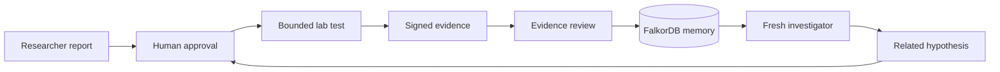
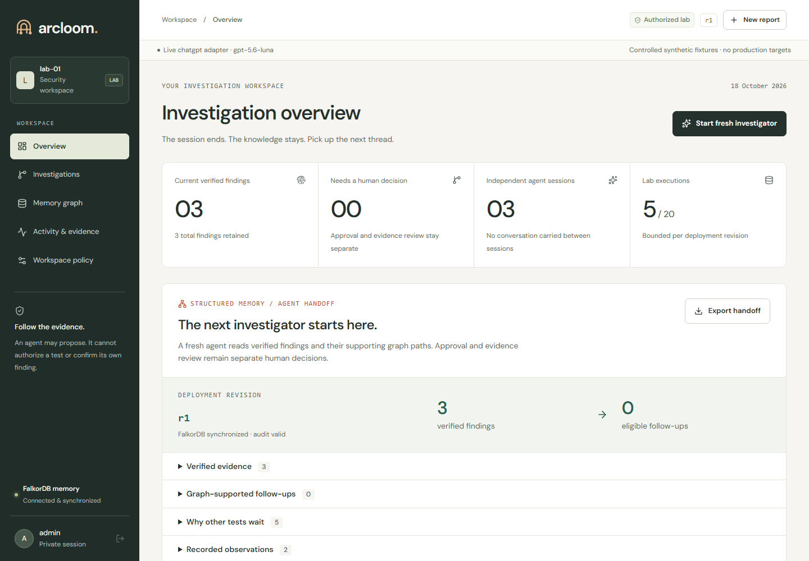
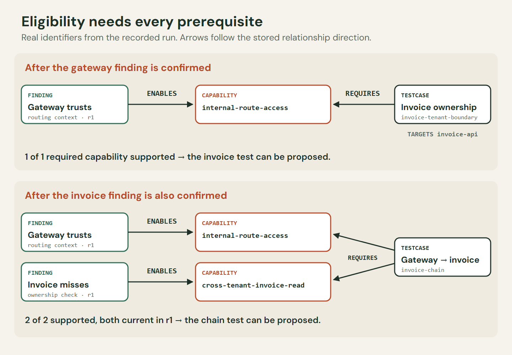

# Arcloom

**Turn one reviewed finding into the next investigation.**

Arcloom gives a fresh investigator a verified starting point. A researcher submits a report, a reviewer approves a bounded synthetic test, and accepted evidence becomes persistent FalkorDB memory. The next investigator follows the graph to a related test - with supporting findings, deployment revision and researcher attribution intact.

[Explore the UI demo](https://arcloom-demo-olbo855az-mokimeows-projects.vercel.app) · [Watch the video](https://youtu.be/Z8RMloVLsig) · [Engineering story](docs/blog/README.md) · [Quickstart](#run-locally) · [Documentation](docs/index.md)

The **[public UI demo](https://arcloom-demo-olbo855az-mokimeows-projects.vercel.app)** lets visitors explore two recorded synthetic states, `r1` and patched `r2`, without logging in. It is clearly labelled and read-only. The [full local application](#run-locally) runs new approved investigations, reviews and optional model calls. [Demo and hosting details](docs/ui-demo.md).

## Watch the investigation continue

[](https://youtu.be/Z8RMloVLsig)

**[Watch the 4:09 demo](https://youtu.be/Z8RMloVLsig)** · [Download the video](docs/media/arcloom-demo.mp4) · [Read the engineering story](docs/blog/README.md)

The walkthrough follows one reviewed gateway finding into a separate invoice investigation and a verified chain. Two fresh investigator processes recover the supporting evidence without prior chat. It then shows negative results, a portable handoff and revalidation after a deployment change.

## From one finding to the next



1. Confirm the gateway routing-context weakness in the synthetic lab.
2. Start a fresh investigator. The verified gateway capability makes the invoice test eligible.
3. Confirm the separate invoice ownership weakness. Both prerequisites now support a sequential chain test.
4. Keep negative and inconclusive outcomes in memory. Advance to patched revision `r2` and revalidate without erasing earlier evidence.

Every new test needs execution approval; every finding needs evidence acceptance. The runner executes five registered synthetic fixtures. It accepts no arbitrary scan URLs or generated shell commands. These are deliberate lab weaknesses, not discoveries in a real company's systems.

## What you can inspect

- **Transferable memory:** independent agent contexts, a tested separate-process handoff and a read-only verified memory packet through the API, MCP bridge or optional browser WebMCP tools. [Agent tools](docs/agent-tools.md).
- **Evidence and provenance:** signed, content-addressed receipts, SHA-256 verification, original researcher attribution and JSON export.
- **Revision-aware reasoning:** all prerequisites need current confirmed support; attempted tests, negative results and historical findings remain visible.
- **Graph tools:** native full-text search, evidence-withdrawal analysis with independent support, PageRank dependency inspection and the actual `GRAPH.EXPLAIN` plan.
- **Controlled work:** durable jobs, fenced execution leases, idempotency, budgets, role-based review and a hash-chained audit journal.
- **An inspectable workspace:** report inbox, evidence review, memory graph, agent activity, provider settings and team roles across desktop and mobile.

The default planner is **deterministic** and needs no model API key. Optional OpenAI API, ChatGPT subscription, Anthropic, Gemini and Cloudflare adapters select from verified graph candidates. Model output is a proposal; provider errors stay explicit. [Configure your own provider](docs/provider-setup.md).



## Why FalkorDB

The graph determines which follow-ups are eligible. The `ENABLES` and `REQUIRES` relationships connect findings, capabilities and tests, and provenance links preserve where a lead came from. A test must have every required capability supported by current findings in the active revision.



```text
(Finding)-[:ENABLES]->(Capability)<-[:REQUIRES]-(TestCase)-[:TARGETS]->(Asset)
(Hypothesis)-[:DERIVED_FROM]->(Finding)
(TestRun)-[:BACKED_BY]->(Evidence)
```

The essential selection query collects requirements and matches verified support before proposing work:

```cypher
MATCH (t:TestCase {enabled: true})-[:REQUIRES]->(needed:Capability)
WITH t, collect(DISTINCT needed.id) AS required
MATCH (t)-[:REQUIRES]->(cap:Capability)<-[:ENABLES]-(f:Finding)
WHERE f.status = 'confirmed' AND f.current = true AND f.revision = $revision
WITH t, required, collect(DISTINCT cap.id) AS satisfied
WHERE size(required) = size(satisfied)
RETURN t.id, required
```

The [full query](src/arcloom/graph.py) also excludes attempted tests and returns supporting paths; application checks enforce catalog, evidence, depth, scope and budgets. SQLite owns transactional workflow state and the graph projection outbox. Evidence files hold receipts. Graph-guided discovery fails closed when FalkorDB is unavailable. See the [schema and consistency model](docs/architecture.md).

## Run locally

Install [uv](https://docs.astral.sh/uv/getting-started/installation/), Python and Node.js. Native Windows has been validated with Python **3.13**; Linux/Lite uses Python **3.14**. The frontend requires Node `^22.22.2 || ^24.15.0 || >=26.0.0`.

```bash
git clone https://github.com/MokiMeow/arcloom.git
cd arcloom
python scripts/configure.py
uv sync --frozen --python 3.13 --extra dev
npm --prefix apps/web ci
npm --prefix apps/web run build
```

`configure.py` creates private random credentials in `.env` and refuses to overwrite an existing file. Keep the generated admin token and runner secret. Choose one graph path:

| Environment | Graph setup |
| --- | --- |
| Windows or Linux with FalkorDB Server/Cloud | Set graph host, port, username, password and TLS in `.env`; [connection guide](docs/cloud-hosting.md). |
| Windows with an existing x86-64 WSL distribution | Run `python scripts/dev_graph.py start`; [helper and persistence](scripts/README.md). |
| Linux with embedded FalkorDBLite | Run `uv sync --frozen --python 3.14 --extra dev --extra lite` and set `ARCLOOM_GRAPH_MODE=lite` in `.env`. |

For a remote graph, use the instance's actual connection settings. A plaintext Cloud Free instance is suitable only for disposable synthetic data; [hosting requirements](docs/cloud-hosting.md) cover migration and storage.

Start these in **separate terminals** from the repository root:

```bash
uv run --frozen arcloom lab
```

```bash
uv run --frozen arcloom serve
```

Open [the workspace](http://127.0.0.1:8000), sign in with `ARCLOOM_ADMIN_TOKEN` from your local `.env`, and run `uv run --frozen arcloom doctor`. The UI/API uses port 8000; the authenticated lab uses port 9001. Keep graph, lab and API available. State persists under ignored `data/`.

### Docker Compose

```bash
python scripts/configure.py  # only for a new checkout without .env
docker compose up --build -d
docker compose exec app arcloom doctor
```

Compose pins FalkorDB **4.22.1** by digest and provides separate app, lab and graph services with persistent volumes. Only the UI is published, on loopback. The app and lab run without root privileges. [Validation and reproduction](docs/testing.md) records the exercised environments and checks.

## Verify the application

```bash
uv run --extra dev ruff check src tests scripts
uv run --extra dev ruff format --check src tests scripts
npm --prefix apps/web run typecheck
npm --prefix apps/web test
npm --prefix apps/web run build
```

For a clean presentation, run `uv run --frozen arcloom demo --workspace data/presentation --port 8002` with the lab still running. It creates or resumes separate persistent memory. [Presentation setup](docs/demo.md#start-a-separate-presentation-workspace).

Backend and browser integration checks require a real FalkorDB instance. [Testing](docs/testing.md) gives Windows/server and Linux/Lite commands and the distinction between contract tests and live inference. In the separate presentation workspace, run `uv run --frozen arcloom agent-once --workspace data/presentation` in a new process after reviewing the preceding result. It proposes one test and pauses at the human checkpoint. Omit `--workspace` to use the normal configured workspace.

## Explore the project

| Start here | Details |
| --- | --- |
| [Documentation index](docs/index.md) | Task-oriented navigation |
| [Demo](docs/demo.md) | Gateway → invoice → chain → revision revalidation |
| [Architecture](docs/architecture.md) | Schema, state transitions, outbox and fresh context |
| [Graph intelligence](docs/graph-intelligence.md) | Search, provenance withdrawal and diagnostics |
| [Provider setup](docs/provider-setup.md) | Your own credentials, saved profiles and diagnostics |
| [Agent tools](docs/agent-tools.md) | Verified handoff packets and read-only MCP access |
| [Operations](docs/operations.md) and [security](docs/security.md) | Persistence, trust boundaries and deployment requirements |
| [AI usage](AI_USAGE.md) | Development assistance and runtime planner disclosure |
| [Engineering story](docs/blog/README.md) | The problem, graph query, implementation and recorded handoff |
| [Project origin](docs/project-story.md) | The owner's idea, product direction and implementation decisions |
| [Public UI demo](docs/ui-demo.md) | Recorded interactive tour, responsive checks and full hosting requirements |
| [Demo assets](docs/media/README.md) | Narrated video, thumbnail and captions |

`src/arcloom/` contains the trusted API, policy, graph tools and runner; `apps/web/` contains the React/TypeScript workspace; `tests/` contains policy, failure, HTTP, graph and process tests.

Built for the FalkorDB hackathon: **Track 02 - Agent Memory and Coordination** is the primary fit; **Track 01 - Agents That Act on Connected Data** is secondary. The demonstration centers on persistent evidence and graph-guided continuation. [AI assistance is disclosed](AI_USAGE.md). Repository rights are governed by the existing [license](LICENSE).
