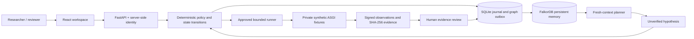

# Architecture and invariants

## Data flow



## Responsibilities

`api.py` authenticates, validates, bounds requests, checks CSRF/origin and routes typed operations. `workflow.py` owns case transitions. `worker.py` claims durable execution jobs with fencing tokens. `discovery.py` constructs a new planner context on every step. `graph.py` owns fixed parameterized Cypher and ordered projections. `lab.py` owns the only executable test catalog and synthetic fixture application. `evidence.py` verifies bytes and signatures. `storage.py` provides atomic transactions and audit records.

An LLM can select one candidate already returned by the graph. It cannot submit a URL, write raw Cypher, broaden scope, choose a shell command, approve itself, or promote its own answer to a finding. The deterministic planner uses the same candidate contract without claiming a model call.

## Memory model

Nodes include Report, Hypothesis, Finding, Capability, TestCase, Asset, TestRun, Evidence, Review, Revision and AgentSession. Findings ENABLE capabilities; TestCases REQUIRE them and TARGET assets. Runs BACK evidence. Hypotheses and later findings retain DERIVED_FROM links to earlier findings.

Candidate eligibility requires all prerequisite capabilities to be supported by current, confirmed findings in the active revision. A previous attempt at that revision suppresses duplicate discovery. Graph results are cross-checked against the trusted test catalog, persisted findings, evidence hashes, revision and depth limit before a case is created.

The graph's stored edges are essential to selecting follow-ups. An outage does not trigger an alternate SQLite or in-memory reasoning engine. Explicit graph doubles exist only in test code.

## State machine

```text
report / graph candidate
  -> awaiting_approval
  -> queued | denied
  -> running
  -> awaiting_review
  -> confirmed | not_reproduced | inconclusive | rejected

inconclusive -> explicit retry request -> awaiting_approval
historical finding -> explicit revalidation -> new revision-scoped case
```

Observation is not review. `reproduced` is a runner outcome; `confirmed` requires review acceptance. The old finding remains historically confirmed after a patch, while `current=false` prevents its use as an active prerequisite. An inaccessible prerequisite yields uncertainty about a downstream flaw, not a fabricated claim that the downstream flaw was fixed.

## Consistency and crash behavior

Journal writes, budget reservations, case transitions, audit records and outbox entries commit together. The projector applies ordered, parameterized MERGEs. Retrying a projection does not duplicate graph entities. Discovery waits for its workspace outbox to synchronize.

Jobs use a durable lease and fencing token. A process that returns after losing its fence cannot commit a successful result. An expired running job becomes inconclusive; it is not automatically executed again. A reviewer may request a new attempt, up to the configured limit. This deliberately avoids promising exactly-once execution over an unreliable boundary.

Admission rechecks scope, assessment expiry, revision, supporting findings, approval expiry, reviewer access and remaining budget. A scope pause blocks new admission; a bounded read-only test already admitted may finish. Revisions cannot advance while jobs are queued or running.

## Fresh context and bounded work

Each discovery constructs a new planner without prior messages. A dedicated integration test terminates process A, starts process B with a different PID, and confirms that the new process selects the invoice follow-up from persisted FalkorDB records. Conversation persistence is not used to manufacture this handoff.

One step selects one hypothesis. Human approvals and reviews advance the continuing investigation loop; there is no unattended infinite exploit generation service. Execution/model reservations, maximum depth, response size, timeout, and per-case retry limits bound work.

## Deliberate tradeoffs

One journal and one bounded worker are sufficient for this demonstration. This is not a high-availability multi-region design. The application and runner are trusted components; a compromised host or runner signing secret is outside the evidence integrity guarantee. A local audit hash chain needs an independently stored head to detect replacement of the entire history. A graph path suggests compatibility; the chain fixture actually tests sequential steps to establish the specific synthetic chain.
