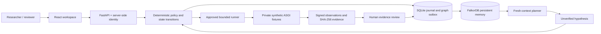

# Architecture and invariants

Arcloom separates proposing an investigation, authorizing execution, observing a result and accepting evidence. FalkorDB is the shared reasoning memory; SQLite is the transactional workflow journal; immutable-by-API receipt files hold execution evidence.

[Documentation index](index.md) · [Security model](security.md) · [Graph tools](graph-intelligence.md)

## Data flow



## Responsibilities

| Component | Responsibility |
| --- | --- |
| [api.py](../src/arcloom/api.py) | Authentication, bounded typed requests, CSRF/origin checks and operation routing |
| [workflow.py](../src/arcloom/workflow.py) | Case transitions, approval, review and revision rules |
| [worker.py](../src/arcloom/worker.py) | Durable jobs and execution fencing |
| [discovery.py](../src/arcloom/discovery.py) | A new planner context for each investigation step |
| [graph.py](../src/arcloom/graph.py) | Fixed parameterized Cypher and ordered graph projections |
| [lab.py](../src/arcloom/lab.py) | Executable test catalog and synthetic fixtures |
| [evidence.py](../src/arcloom/evidence.py) | Artifact and signature verification |
| [storage.py](../src/arcloom/storage.py) | Atomic journal transactions and audit records |

A model selects one candidate returned by the graph. It cannot supply an arbitrary URL, raw Cypher or shell command, broaden scope, approve itself or promote its answer to a finding. The deterministic planner uses the same candidate contract without making a model call.

## Memory schema and selection

Node labels include `Report`, `Hypothesis`, `Finding`, `Capability`, `TestCase`, `Asset`, `TestRun`, `Evidence`, `Review`, `Revision`, `AgentSession` and `TrustBoundary`. All use an `Entity` identity label. Workspace-derived graph names isolate projections.

```text
(Finding)-[:ENABLES]->(Capability)<-[:REQUIRES]-(TestCase)-[:TARGETS]->(Asset)
(Finding)-[:BACKED_BY]->(TestRun)-[:BACKED_BY]->(Evidence)
(Hypothesis)-[:PRODUCED]->(TestRun)-[:EXECUTED]->(TestCase)
(Finding)-[:DERIVED_FROM]->(Finding)
(Hypothesis)-[:DERIVED_FROM]->(Finding)
```

Candidate selection requires every prerequisite capability to have current confirmed support in the active revision. A previous attempt at that revision suppresses duplicate discovery. The [essential query in the README](../README.md#why-falkordb) illustrates the all-prerequisite check; [FOLLOWUPS_CYPHER](../src/arcloom/graph.py) is the complete executable query, including source filtering, attempts and supporting paths.

Graph candidates are checked against the trusted catalog, persisted findings, evidence hashes, revision and depth limits before a case is created. Graph outages block discovery and new test admission; there is no alternate SQLite reasoning engine. Test doubles are explicitly injected by unit tests.

## State transitions

```text
report / graph candidate
  -> awaiting_approval
  -> queued | denied
  -> running
  -> awaiting_review
  -> confirmed | not_reproduced | inconclusive | rejected

inconclusive -> explicit retry request -> awaiting_approval
historical finding -> explicit revalidation -> new revision-scoped case
```

`reproduced` is an observation; `confirmed` requires review acceptance. A patched revision preserves the old finding's historical confirmation while `current=false` excludes it from active prerequisites. An inaccessible prerequisite creates uncertainty about a downstream flaw rather than evidence that the flaw is fixed.

## Consistency and recovery

Journal writes, budget reservations, case transitions, audit records and outbox entries commit together. The projector applies ordered parameterized `MERGE` operations. Replaying a projection does not duplicate its entities. Discovery waits for the workspace outbox to synchronize.

Durable execution leases carry fencing tokens. A process that returns after losing its fence cannot commit success. An expired running job becomes inconclusive and requires a newly approved attempt; this avoids promising exactly-once execution across an unreliable boundary.

Admission rechecks scope, assessment expiry, revision, supporting findings, approval expiry, reviewer access and budget. Pausing scope blocks new admission; an already-admitted bounded read-only test may finish. Revisions cannot advance while jobs are queued or running.

## Fresh context and bounded work

Each discovery constructs a planner without prior messages. The process integration test terminates one process and starts another with a distinct PID; the second selects the invoice follow-up from persisted FalkorDB records. Conversation persistence is not needed for that handoff.

One step proposes one hypothesis. Human approvals and reviews advance the loop. Model/execution reservations, maximum depth, response bounds, deadlines and per-case retry limits bound work. [Testing](testing.md) records the actual-engine and provider checks.

## Operating assumptions

The demonstration uses one journal and bounded worker. Application and runner hosts are trusted. HMAC evidence establishes integrity relative to the signing runner; a compromised host or signing key is outside that trust boundary. Detecting replacement of the entire audit history requires an independently stored head hash. A graph path identifies supported prerequisites; the sequential chain fixture establishes only the specific executed synthetic chain.
