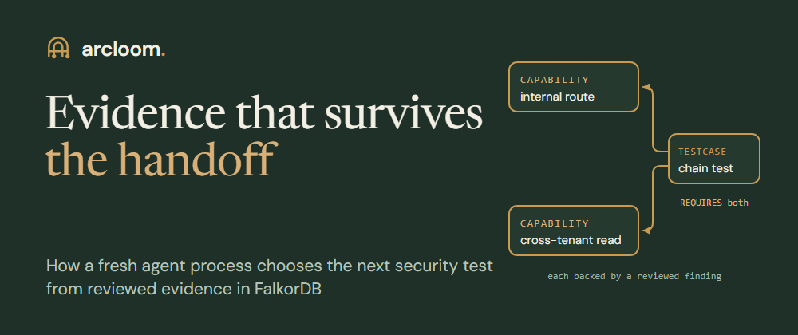
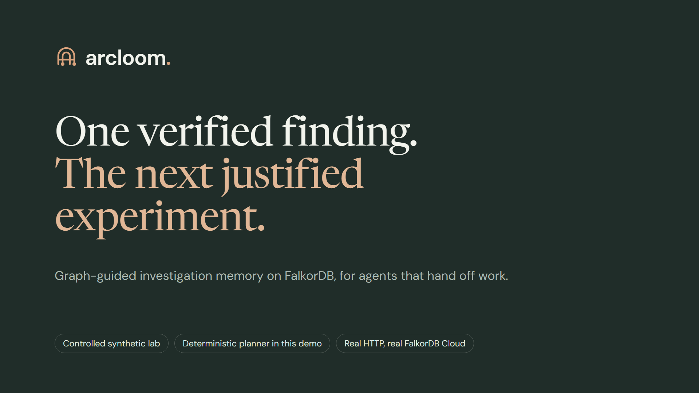
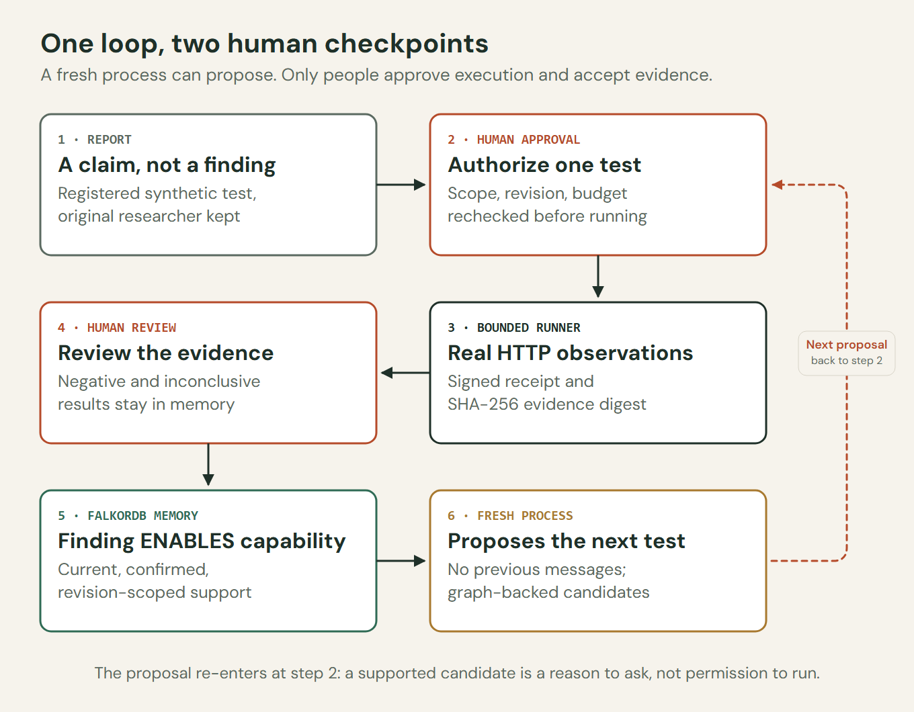
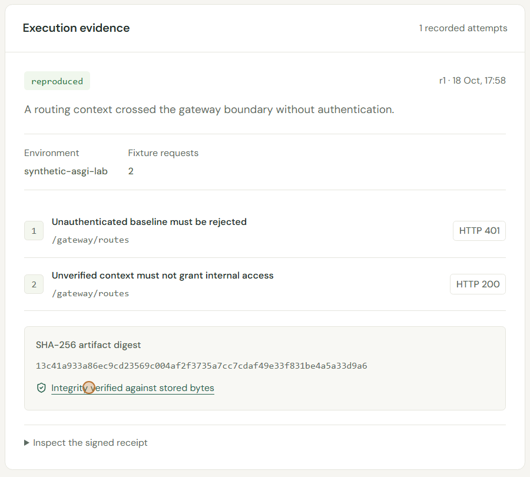
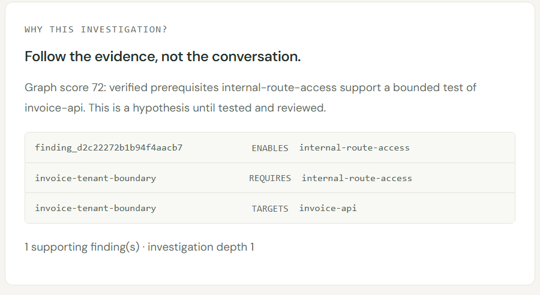
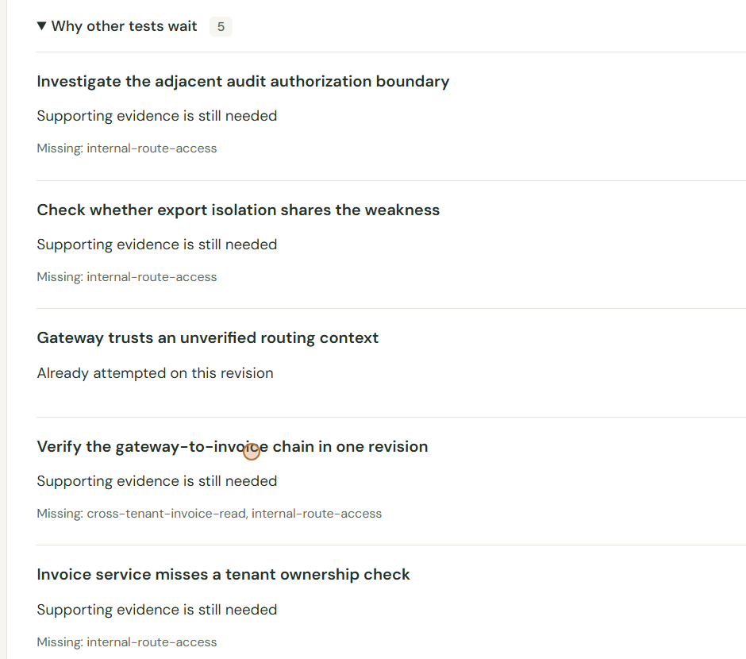

# Evidence that survives the handoff



*[Development and AI disclosure](https://github.com/MokiMeow/arcloom/blob/main/AI_USAGE.md).*

## The moment after the handoff

At 17:59:01 IST on 18 October, a new operating-system process started on our lab machine. Its job was to decide what a security investigation should test next. It had no chat history to read: its output reports `"previous_messages": 0`. Earlier in the run, a gateway test had been approved and executed, and its recorded evidence accepted. The new process received none of the earlier conversation.

That is the situation this post is about. Agent work is increasingly handed from one context to another: a session times out, a different model takes over, a teammate picks up the case, a scheduled job continues overnight. The usual inheritance is a transcript, and a transcript is a poor starting point. It mixes observations with guesses, it does not say which claims were reviewed, and it cannot tell the next reader whether anything has changed since it was written.

We built **Arcloom** for Graph Hacks to explore a different inheritance: reviewed evidence, stored as a graph in FalkorDB, with relationships that say exactly which next experiment that evidence supports. Process 33588 read that graph and selected a test whose prerequisites were all satisfied. A second fresh process, 39736, later did the same for a chain that needed two findings. Neither saw the other's reasoning. They saw the same memory.

Everything that follows runs against deliberately vulnerable synthetic HTTP services that we registered ourselves. Arcloom does not scan arbitrary targets, discover vulnerabilities in real companies, or patch anything. The question it explores is narrower and, we think, more transferable: how should one agent's verified work become a safe, inspectable starting point for the next?

[](https://youtu.be/Z8RMloVLsig)

## Four states that never blur

The first design decision was to keep four things apart that agent systems often merge: a **report**, a **proposed test**, a **runner observation**, and a **reviewed finding**.



*Design diagram. A supported proposal returns to approval before any further execution.*

A report is somebody's claim. Arcloom records it with the original researcher's attribution and links it to a test from a fixed registry, but it confirms nothing. Before anything executes, a person approves that specific registered test. A bounded runner then makes real HTTP requests to the synthetic lab, records what happened, and signs a receipt over the evidence. A second, separate human decision reviews those observations. Only an accepted review produces a confirmed finding, and only confirmed findings become memory that can justify more work.

A fresh agent sits at the end of this loop, and it re-enters at the approval step. Its proposal is a reason to ask for permission, never the permission itself.

## A claim becomes evidence

Our first report described a gateway that trusts an unverified routing context. The registered test checks two things: an unauthenticated request must be rejected, and a request carrying the seeded routing marker must also be rejected. In revision `r1` of the lab, the first returned HTTP 401 and the second returned HTTP 200.



*Actual synthetic gateway evidence from the recorded r1 run. Observations remain separate from review acceptance.*

The runner stores those observations as content-addressed evidence with a SHA-256 digest and an HMAC-signed receipt. The integrity check shown above recomputes the digest from the stored bytes. Accepting the outcome is a separate review action with its own written rationale.

That confirmed finding now *enables* a capability called `internal-route-access`. This is where the graph begins to matter.

## Memory as prerequisites

Arcloom's core model fits on one line:

```text
(Finding)-[:ENABLES]->(Capability)<-[:REQUIRES]-(TestCase)-[:TARGETS]->(Asset)
```

Findings enable capabilities. Registered tests require capabilities and target assets. The arrow from a test points at what it needs, which is why `REQUIRES` runs right to left in the diagrams. A test is eligible only when every capability it requires has current, confirmed support in the active deployment revision.


*Explanatory diagram using the identifiers and relationship directions stored in the recorded run.*

The important word is *every*. The invoice ownership test needs one capability. The chain test needs two: one from the gateway weakness and one from a separate invoice weakness that has to be observed and reviewed on its own. The invoice issue is not implied by the gateway issue. The graph only says the gateway finding makes the invoice test worth attempting.

Here is the query discovery actually runs, `FOLLOWUPS_CYPHER` from [`src/arcloom/graph.py`](https://github.com/MokiMeow/arcloom/blob/main/src/arcloom/graph.py), unabridged:

```cypher
MATCH (t:TestCase {enabled: true})-[:REQUIRES]->(needed:Capability)
WITH t, collect(DISTINCT needed.id) AS required
MATCH (t)-[:REQUIRES]->(cap:Capability)<-[:ENABLES]-(f:Finding)
WHERE f.status = 'confirmed' AND f.current = true AND f.revision = $revision
WITH t, required, collect(DISTINCT cap.id) AS satisfied,
     collect(DISTINCT f.id) AS supporting, max(f.depth) AS prior_depth,
     collect(DISTINCT f.id + '|' + cap.id) AS links
WHERE size(required) = size(satisfied)
  AND ($source_id = '' OR $source_id IN supporting)
OPTIONAL MATCH (old:Hypothesis)
WHERE old.test_id = t.id AND old.revision = $revision
WITH t, required, supporting, prior_depth, links, count(old) AS attempts
WHERE attempts = 0
RETURN t.id, t.asset_id, t.title, required, supporting, t.impact, prior_depth, links
ORDER BY t.impact DESC, t.id
LIMIT 20
```

Reading it top to bottom:

- The first `MATCH` collects everything each enabled test requires.
- The second keeps only support from findings that are confirmed, current, and in the active revision.
- `size(required) = size(satisfied)` is the all-prerequisites rule. One missing capability removes the test.
- The `OPTIONAL MATCH` on earlier hypotheses suppresses tests already attempted in this revision, so a negative result is not proposed again tomorrow.
- `links` returns the exact finding-to-capability pairs, so every proposal carries its own explanation.

The query is parameterized and fixed. The planner cannot substitute its own Cypher, target URLs, or shell commands. Eligibility from the graph is also not the last word. Before a case is created, the application checks each candidate against the trusted test registry (a mismatch fails with `graph_catalog_mismatch`), the persisted findings, evidence hashes, depth limits and budgets. Then the proposal still waits for a human to approve execution.

## Two fresh processes, one chain

Process 33588 ran `agent-once` against the persisted workspace. This is an excerpt of its real standard output:

```json
{
  "process_id": 33588,
  "previous_messages": 0,
  "status": "proposed",
  "provider": "deterministic",
  "selection": {
    "test_id": "invoice-tenant-boundary",
    "asset_id": "invoice-api",
    "finding_ids": ["finding_d2c22272b1b94f4aacb7"]
  }
}
```

It considered three graph candidates and chose the invoice ownership test, citing the gateway finding. The case it created shows the same path, read back from the stored relationships:



*Actual invoice case. Its supporting path is inspectable before execution is approved.*

After approval, the invoice test reproduced a separate weakness: a synthetic tenant-alpha principal read a tenant-beta invoice. That was reviewed and confirmed, and it enabled `cross-tenant-invoice-read`. Process 39736 then started fresh, again with zero previous messages, and proposed `invoice-chain` with two supporting findings. The chain ran its three requests in order, under one synthetic identity and one revision, and was reviewed like everything else.

The recorded demo used Arcloom's deterministic planner, labelled as such on screen, so the run is repeatable. Optional model providers choose from the same graph-supplied candidates. In separate recorded runs, ChatGPT (`gpt-5.6-luna`) and Gemini each carried the gateway → invoice → chain sequence through live calls. A Cloudflare model abstained below its confidence threshold, and we kept that as an honest result rather than lowering the bar. A provider error never silently switches to another provider.

These were sequential, independent contexts. They were not a swarm of concurrent specialists. The process boundary matters less than what crossed it: no conversation, only reviewed evidence and the graph.

## Remembering what didn't work

Two other registered tests ran in the same session. The export test received HTTP 403, so its outcome is `not_reproduced`. The audit service returned HTTP 503, so its outcome is `inconclusive`: an unavailable dependency supports no conclusion either way.

Neither became a finding, and neither enables a capability. Both stay in memory as reviewed observations, and the attempt-suppression clause above keeps them from being proposed again in the same revision. The handoff briefing makes the difference visible: three confirmed findings, one negative observation, one inconclusive observation, and zero eligible follow-ups, because every supported test had already been tried.

## When the deployment changes

Findings describe a system at a point in time. In Arcloom, a workspace has an active revision, and advancing it to a patched `r2` changes what counts as current.



*Actual handoff briefing after r2 revalidation. Missing prerequisite support blocks the chain.*

The `r1` findings remain in the journal with their receipts. Their stored `current` flag becomes false, so they stop satisfying the query, and the chain shows exactly which capabilities it now lacks. Revalidation is explicit. We re-ran the gateway test on `r2`, both requests returned HTTP 401, and the review recorded `not_reproduced` while keeping the `r1` finding as history.

A blocked gateway can stop this particular chain. It does not prove the invoice service downstream is secure, so Arcloom says "support missing", not "fixed". Before the revision change, a read-only withdrawal analysis asked a related question: if the gateway finding were withdrawn, which tests lose support? All four dependent tests did, because no independent finding enabled the same capabilities in this run. The analysis is built to keep a capability alive when another finding provides it. It just had nothing to keep here.

## Keeping the graph honest

FalkorDB is the reasoning memory, but it is not where state transitions are decided. A local SQLite journal owns those.


*Architecture diagram. Workflow transactions and recoverable graph projection have different responsibilities.*

A graph-relevant workflow transition commits its case state, audit entry, budget changes and graph-outbox entry together in one SQLite transaction. A projector applies those rows to FalkorDB in order with parameterized `MERGE`s, so replaying them never duplicates entities. Discovery waits until the outbox is empty before it reads candidates.

We saw that guard work during the recorded run. The second process started while the server still held the projection lease, exited with "Graph synchronization is in progress", and proposed nothing. A retry moments later succeeded. If FalkorDB is unreachable, discovery fails with `graph_unavailable` and the message "No fallback memory was used". We chose that deliberately. Nothing reconstructs eligibility from the journal behind the graph's back, so a proposal can always be traced to a query that actually ran.

For the hackathon the graph lives in a FalkorDB Cloud instance in AWS `ap-south-1`. The API, journal, evidence files and lab run locally. Read-only queries extracted a 15-node, 22-relationship subgraph of findings, capabilities, test cases and assets from the demo workspace. That is a focused view of the stored records used to explain eligibility, rather than a claim about the size of the whole database.

## A handoff another agent can verify

The same memory is available as a packet. `GET /api/memory/handoff` returns the active revision, current findings with original attribution, evidence identifiers and digests, receipt signature checks, candidate paths, blocked reasons and observations. It also includes a `packet_sha256` over the canonical JSON of the packet, which lets a receiver detect changes. It is an integrity check, not a signature or an authorization.

```json
{
  "workspace": { "revision": "r1" },
  "audit": { "valid": true, "checked": 37 },
  "summary": {
    "confirmed_current": 3,
    "negative_current": 1,
    "inconclusive_current": 1,
    "eligible_followups": 0
  },
  "packet_sha256": "5b1acf32d67c212a29c17ea90efc1265ddebb29db6d4088726280c80ebca7d53"
}
```

We recomputed that digest independently from the exported file, and it matched. External agents can read the same memory through a small MCP server built on the official Python SDK, with three read-only tools: `arcloom_handoff`, `arcloom_investigations` and `arcloom_investigation`. A real stdio client exercised all three against the running API with a temporary viewer token. Reading memory creates no agent session, calls no model and authorizes nothing.

## What the recorded checks establish

The recorded checks for the submitted tree are 539 Python tests passed (2 skipped for Windows symlink privileges) against an actual FalkorDB server, 97 frontend tests, and 8 Chromium scenarios driving the real UI against a real graph and a separate HTTP lab. A dedicated integration test starts two operating-system processes and checks that the second continues from persisted graph records.

The browser and live-provider harnesses exercised approval and review as the test owner; they did not supply independent human adjudication. Those checks show the exercised paths work. They are not a measure of model accuracy, a security certification, or evidence of production load. The vulnerabilities are seeded fixtures. Confidence values from models are decision signals, not probabilities that a weakness exists.

## Reproduce the handoff

The [README setup](https://github.com/MokiMeow/arcloom#run-locally) connects your own FalkorDB instance and starts the application and HTTP lab. The default deterministic planner needs no model API key.

Start with the gateway report, approve its registered test, inspect its evidence and accept the review. Select **Start fresh investigator** and open the proposed invoice case's supporting path. After confirming that separate issue, repeat the handoff for the chain. Finally, advance to `r2` and compare current support with retained history. The useful thing to inspect is the reason each next step becomes available—or waits.

## What we would carry into other agent systems

1. **Hand over evidence with its status attached.** Report, proposal, observation and accepted finding are different facts. Keeping them separate made every later decision easier to explain.
2. **Make eligibility a query, not a judgement call.** An all-prerequisites rule in Cypher is short, testable and returns its own justification. A model can rank the results. It does not get to invent them.
3. **Scope memory to time.** A revision flag on findings turned "is this still true?" from a worry into a filter, and it kept history intact.
4. **Remember failure.** Negative and inconclusive results kept fresh agents from proposing completed tests again in the same revision.
5. **Fail closed when memory is unavailable.** A missing graph should stop discovery, not quietly degrade it into guessing.

The gateway, invoice and chain are small synthetic fixtures. The shape of the problem is not: one context ends, another begins, and the second one should start from what was actually verified, know why it may act next, and notice when that support has expired.

The code, setup instructions, graph model and queries are in the [Arcloom repository](https://github.com/MokiMeow/arcloom). The project was built for [WeMakeDevs Graph Hacks](https://www.wemakedevs.org/hackathons/falkordb), primarily for the Agent Memory and Coordination track, with Agents That Act on Connected Data as a second fit.
